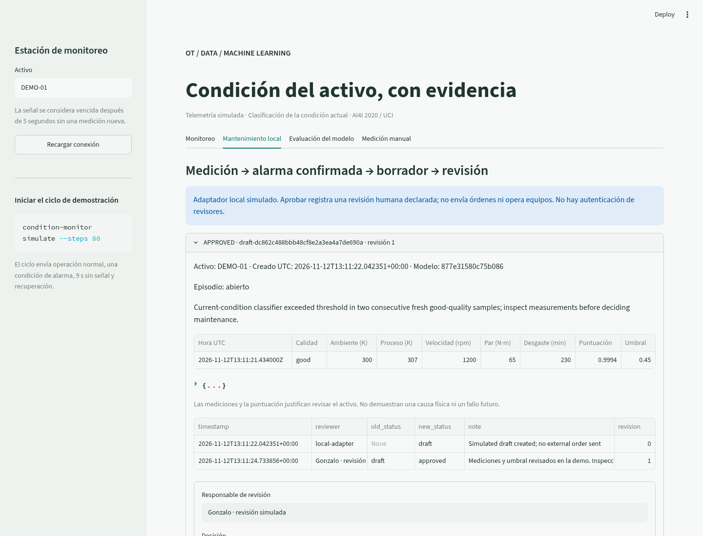

# Industrial Condition Monitor

English · [Español](README.es.md)

A local demonstration for maintenance engineers and OT/IT developers: **measurement → current condition → confirmed alarm episode → maintenance draft → human review**. Uses synthetic AI4I 2020 observations; it does not predict future failures or remaining life.



## Run locally

Python 3.11–3.14 and uv; tested here with Python 3.12.14 and the existing lock file.

```bash
uv sync --locked --extra dev
uv run --no-sync condition-monitor train
uv run --no-sync condition-monitor serve
# Separate terminals, same directory:
uv run --no-sync condition-monitor dashboard
uv run --no-sync condition-monitor simulate --steps 80
```

Open [dashboard](http://127.0.0.1:8501) and [API](http://127.0.0.1:8000/docs). The simulator cycles through normal operation, alarm, nine seconds without telemetry and recovery. In **Mantenimiento local**, inspect the evidence, enter a reviewer and reason, and save a decision. Approval only changes the local record.

## Architecture and guarantees

A single persisted preprocessing/classification pipeline serves training and inference. FastAPI validates physical units, asset IDs, UTC timestamps and quality. SQLite atomically records the measurement, alarm state, episode and draft. Two fresh good-quality alarm samples confirm; two normal ones recover. Gaps/bad quality reset counters and leave open episodes intact. Stale signals are unknown; bad/uncertain quality is invalid and is not scored.

Event retries with identical IDs/payloads return the stored result. Conflicting IDs and out-of-order timestamps return 409. Measurement idempotency is bounded by retention (1,000 events per asset, 20 assets); drafts and their copied evidence/history persist beyond that retention. Reviews use optimistic revisions, return 409 on a stale revision, and record every status change. There is no external dispatch or reviewer authentication. Only use on localhost.

## Reproduce verification

```bash
uv run --no-sync pytest
uv run --no-sync ruff check src tests scripts
uv run --no-sync ruff format --check src tests scripts
uv run --no-sync python scripts/maintenance_demo.py
uv run --no-sync python scripts/check_notebook.py
uv build
```

The offline replay uses an explicit logical clock and a temporary database; it tests ten retries, reopening storage, signal loss, recovery, a new episode and review. [Generated replay](reports/metrics/maintenance-replay.json). The HTTP simulator and browser screenshots use real services. Compose remains available: `docker compose --profile demo up --build -d --wait` (loopback API 8000/UI 8501).

Training uses published row order: 60% training, 20% threshold validation, 20% untouched test. Label-derived fields and identifiers are excluded. There are no acquisition timestamps or verified asset groups in AI4I. On 2,000 test rows / 39 failures, the unchanged model detected 28, missed 11 and produced 2 false alarms; the depth-three rules detected 29, missed 10 and produced 91 false alarms. [Full evaluation](reports/metrics/evaluation.json). Measurements and threshold exceedance support inspection, not a proven physical cause.

## Documentation

- [Contract, units, quality and API](docs/CONTRACT.md)
- [Maintenance decisions and Spanish interview explanation](docs/MAINTENANCE.md)
- [2–3 minute demo](docs/DEMO.md)
- [Implementation status and traceability](docs/IMPLEMENTATION_STATUS.md)
- [Model card](docs/MODEL_CARD.md), [data provenance](data/README.md), [historical research](docs/research/LEGACY_MAINTENANCE.md)
- [Prior validation](docs/VALIDATION.md) and [new browser observations](docs/evidence/maintenance-browser.json)

Author: [GzoC](https://github.com/GzoC). Code: MIT. AI4I 2020, UCI DOI 10.24432/C5HS5C: CC BY 4.0; attribution in data/README.md. No factory deployment, avoided downtime or industrial savings are claimed. Do not connect the demo to production control systems.
