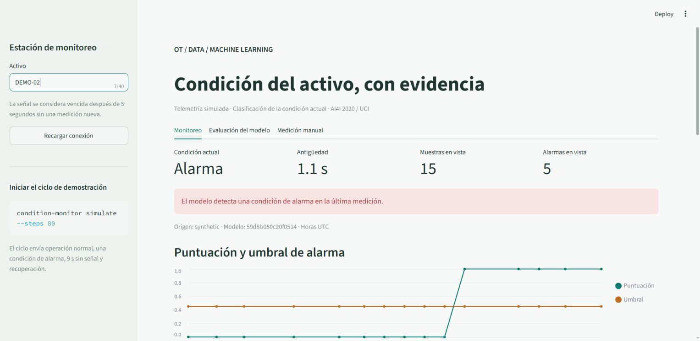

# Industrial Condition Monitor

**De una medición física a una clasificación trazable: modelo, telemetría y calidad de señal.**

Python · scikit-learn · FastAPI · Streamlit · SQLite

Demostrador de clasificación de condición industrial con datos sintéticos AI4I 2020. El modelo detecta la condición de la observación; no se atribuye anticipación de fallas futuras. El nombre histórico del repositorio se conserva.

[](https://github.com/GzoC/real_time_predictive_monitoring/actions/workflows/ci.yml)



[Demo grabada (~49 s)](docs/evidence/walkthrough.mp4) · [Guion de demostración](docs/DEMO.md) · [Pruebas y evidencia](docs/VALIDATION.md)

**Recorrido:** medición con unidades → pipeline persistido → API → SQLite → dashboard. La reconstrucción base está integrada en main; esta continuación completa gráficos, validación visual y evidencia. [Estado de entrega](docs/IMPLEMENTATION_STATUS.md).

## Ejecutar localmente

Con Python 3.11–3.14 y uv:

```bash
git clone https://github.com/GzoC/real_time_predictive_monitoring.git
cd real_time_predictive_monitoring
uv sync --locked --extra dev
uv run --no-sync condition-monitor train
uv run --no-sync condition-monitor serve
```

En otra terminal del mismo directorio:

```bash
uv run --no-sync condition-monitor dashboard
```

Abre http://127.0.0.1:8501. Inicia un ciclo de datos desde una tercera terminal:

```bash
uv run --no-sync condition-monitor simulate --steps 80
```

El ciclo incluye operación normal, condición de alarma, nueve segundos de ausencia de señal y recuperación. Los valores son reproducibles; los timestamps corresponden al instante de envío. Detén los servicios con Ctrl+C. API interactiva: http://127.0.0.1:8000/docs.

## Qué demuestra

- Un único pipeline guarda las transformaciones y el clasificador. CLI, notebook y API reciben las mismas unidades y características.
- El umbral se elige en validación; el conjunto de prueba permanece reservado. Las etiquetas de tipos de fallo y los identificadores no entran al modelo.
- Cada evento conserva su activo, hora UTC, origen declarado, puntuación y versión del modelo. Los reenvíos no duplican una medición retenida.
- La pérdida de señal produce estado desconocido. El dashboard muestra la antigüedad, las alarmas y los valores fuera del rango de entrenamiento; corta los trazos cuando faltan más de cinco segundos de señal.
- Dependencias bloqueadas, paquete instalable y configuración Docker que instala el código sin montajes del checkout.

## Resultado medido

Holdout de 2.000 observaciones con 39 fallos:

| Método | Fallos detectados | Fallos omitidos | Falsas alarmas |
|---|---:|---:|---:|
| Gradient Boosting | 28 | 11 | 2 |
| Reglas de profundidad 3 | 29 | 10 | 91 |
| Siempre normal | 0 | 39 | 0 |

La mejora consiste en menos falsas alarmas con una detección ligeramente menor que las reglas. El modelo omite 11 fallos y no está validado para decidir mantenimiento industrial. [Datos y atribución](data/README.md) · [Modelo y limitaciones](docs/MODEL_CARD.md) · [Resultado completo](reports/metrics/evaluation.json).

## Contenedores

```bash
docker compose --profile demo up --build -d --wait
```

API en 8000, dashboard en 8501, ambos publicados solo en loopback. El simulador termina después de 120 pasos de reloj; las fases sin señal no envían eventos. Para repetir: `docker compose run --rm simulator`. El dashboard usa el nombre de servicio `api`, no localhost, para comunicarse dentro de Compose. GitHub Actions comprueba la construcción real, salud de servicios e ingestión HTTP; [alcance y ejecuciones](docs/VALIDATION.md).

## Reproducir la evaluación

```bash
uv run --no-sync pytest --cov=predictive_monitor --cov-report=term-missing
uv run --no-sync ruff check src tests scripts
uv run --no-sync python scripts/check_notebook.py
uv build
```

El entrenamiento genera `var/model/pipeline.joblib`, un manifiesto JSON con hash de datos, versiones y métricas, y las reglas de referencia. Solo se cargan artefactos locales confiables. La comprobación de checksum detecta corrupción; no autentica modelos de terceros. Tras volver a entrenar, reinicia la API para usar el nuevo modelo.

## Documentación

- [Contrato, unidades y estados HTTP](docs/CONTRACT.md)
- [Procedencia y licencia de datos](data/README.md)
- [Modelo, evaluación y límites](docs/MODEL_CARD.md)
- [Migración e historial preservado](docs/MIGRATION.md)
- [Demo de dos minutos y decisiones de diseño](docs/DEMO.md)
- [Validación, capturas y alcance de las pruebas](docs/VALIDATION.md)
- [Estado de validación](docs/IMPLEMENTATION_STATUS.md)

English: Reproducible industrial current-condition classification with a persisted preprocessing pipeline, held-out evaluation and a live synthetic telemetry demonstration. No future failure horizon or factory deployment is claimed.

Autor: [GzoC](https://github.com/GzoC). Código MIT. Dataset AI4I 2020 / UCI: CC BY 4.0, atribución en data/README.md.
